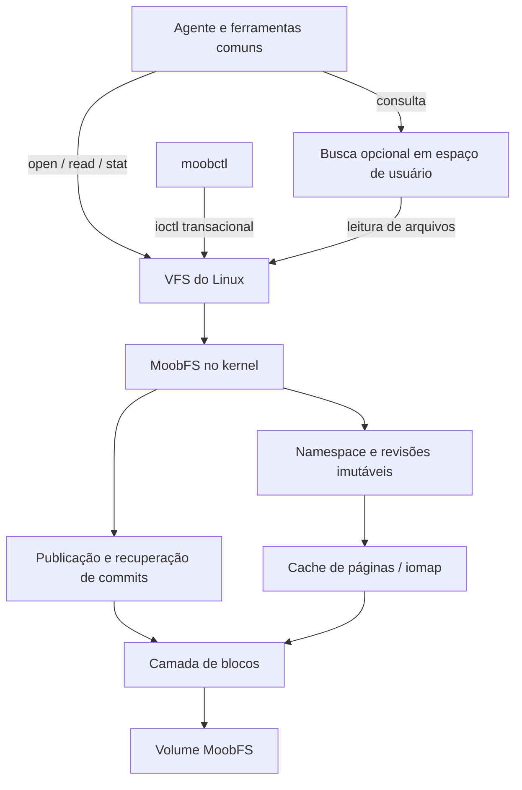

# MoobFS: MVP nativo no Linux

Data: 10 de outubro de 2026. Estado: proposta de arquitetura, sem implementação.

## 1. Objetivo e recorte

Construir um filesystem de blocos que o Linux monte como tipo `moobfs`, implementado por um módulo carregável `moobfs.ko`. Ele deve armazenar memórias persistentes, compartilhar conteúdo idêntico e expor versões estáveis como arquivos convencionais. O módulo atende as leituras diretamente pelo VFS; não há FUSE ou serviço obrigatório no caminho de leitura.

O MVP completo precisa aceitar novas memórias enquanto está montado e recuperá-las após reinicialização. Uma imagem somente para leitura será a primeira entrega técnica, não o término do MVP.

Decisões iniciais:

| Aspecto | Decisão |
| --- | --- |
| Implementação | Módulo externo em C e ferramentas de usuário em C; testes podem usar Python/shell. |
| Ambiente | VM Linux x86-64, páginas de 4 KiB, kernel e configuração fixados antes da primeira compilação. Registrar versão exata, commit, configuração e compilador. |
| Dispositivo | Um dispositivo de blocos local; arquivo de imagem com loop para testes básicos e disco virtual dedicado para falhas. |
| Unidade de conteúdo | Objeto de até 64 KiB, identificado internamente por ID e pesquisável pelo hash de seus bytes. |
| Gravação | Publicação transacional de objetos/revisões/snapshots; um commit por vez por volume. |
| Leitura | `open`, `read`, `pread`, `stat`, enumeração de diretórios e `lseek` em arquivos imutáveis. |
| Compartilhamento | Objetos inteiros idênticos, sem normalização do texto. |
| Histórico | Revisões e snapshots imutáveis, preservados durante toda a vida do volume v0. |
| Permissões | Um domínio de confiança por volume; proprietário definido na montagem. Sem isolamento entre agentes no v0. |

Não fazem parte do v0: edição POSIX arbitrária, `mmap`, I/O direto, hard links criados pelo usuário, reflink ioctl padrão, exclusão, coleta de lixo, compressão, rede, ACLs, montagem simultânea em máquinas diferentes ou processamento semântico no kernel. Uma operação não suportada deve falhar explicitamente.

## 2. Arquitetura



O módulo implementa o registro no VFS, montagem, inodes, diretórios, leitura, controle transacional e acesso ao dispositivo de blocos. Usa os drivers de disco existentes.

O serviço opcional de busca mantém índices reconstruíveis fora do volume, por exemplo em SQLite. Ele pode selecionar memórias e montar contexto, mas não participa de uma leitura comum nem é necessário para montar ou recuperar o filesystem. Conteúdo e origem persistem no MoobFS.

A integração será baseada na API de montagem com `fs_context`, cache de páginas com folios e mapeamento de leitura por `iomap`. As assinaturas concretas serão verificadas no código do kernel fixado, pois documentação de versões diferentes não substitui a compilação contra esse alvo.

## 3. Modelo de dados

| Entidade | Campos conceituais |
| --- | --- |
| Objeto | `object_id`, SHA-256, tamanho original, localização do payload. |
| Memória | `memory_id`, número da última revisão confirmada. |
| Revisão | `memory_id`, `revision`, `object_id`, metadados opacos, instante de publicação. |
| Snapshot | `snapshot_id`, lista ordenada de pares `(memory_id, revision)`. |
| Transação | `request_id`, geração, resultado, registros e limite final confirmado. |

IDs são inteiros de 64 bits, relativos ao UUID do volume. IDs confirmados nunca são reutilizados. O hash não é usado como inode ou como única prova de igualdade.

```text
Memória 41, revisão 1 ─┐
                      ├─ objeto 18 ─ payload no volume
Memória 72, revisão 1 ─┘

Memória 41, revisão 2 ─── objeto 25 ─ outro payload
```

Na inserção, o módulo calcula SHA-256, consulta candidatos por hash e tamanho e compara seus bytes. Só reutiliza um objeto após igualdade exata. Uma colisão de hash com bytes diferentes cria outro `object_id` no mesmo grupo de candidatos.

Origem, classificação e demais informações ficam na revisão, não no objeto compartilhado. O módulo aceita até 4 KiB de metadados opacos por revisão; a CLI os apresenta como JSON UTF-8. O kernel valida tamanho e enquadramento, não interpreta JSON ou linguagem natural. Texto de conteúdo é preservado como bytes, inclusive diferenças de espaços e quebras de linha.

O snapshot fixa no máximo uma revisão por memória. Ele copia referências, não os dados dos objetos. Não se promete snapshot em tempo constante: o manifesto inicial é uma lista e seu custo é proporcional ao número de entradas.

## 4. Namespace e semântica de leitura

Exemplo ilustrativo, ainda não existente:

```text
/mnt/moob/
  .control
  memories/
    41/
      revisions/
        1/
          content
          metadata.json
        2/
          content
          metadata.json
  snapshots/
    9/
      manifest
      memories/
        41/
          content
          metadata.json
```

`content` contém exatamente os bytes publicados. `metadata.json` contém os metadados daquela revisão; a CLI exige JSON válido, embora o filesystem os trate como bytes. `manifest` é uma representação determinística do conjunto fixado pelo snapshot.

Cada arquivo publicado tem inode estável durante a vida do volume. A alocação de inodes e IDs faz parte da transação; não usar o hash truncado para produzi-los. O registro de snapshot reserva os inodes necessários às suas entradas.

Abrir uma revisão fixa sua identidade; uma nova publicação não altera o arquivo aberto. O v0 não expõe um arquivo `latest` cujo conteúdo mude. Para descobrir a revisão atual, a CLI consulta o controle ou lista revisões.

Os arquivos de conteúdo são imutáveis, com tamanho lógico igual ao tamanho original. Bytes de alinhamento em disco não aparecem na leitura. Leituras além do fim retornam EOF.

Arquivos diferentes que referenciam o mesmo objeto podem ter inodes e páginas de cache separados. Deduplicação no disco não implica deduplicação de RAM. Compartilhar também o cache não é uma meta do v0.

Novas entradas devem invalidar dentries negativas correspondentes. Diretórios usam cookies de enumeração baseados em IDs estáveis. Uma enumeração concorrente pode exigir uma nova chamada para encontrar entradas recém-publicadas; um snapshot mantém conteúdo fixo. Publicação no índice de lookup é atômica em relação aos leitores.

## 5. Interface de gravação

`.control` é um arquivo de controle do próprio filesystem. Em um mount gravável, a CLI o abre com acesso de escrita e usa ioctls específicos; o módulo verifica modo do descritor, proprietário e estado do mount. Montagem `ro` rejeita qualquer mutação com `EROFS`. As operações de mutação participam do controle de escritores do VFS, para coordenar freeze, remount somente para leitura e desmontagem; conferir apenas uma flag local não é suficiente.

| Operação proposta | Contrato |
| --- | --- |
| `GET_INFO` | UUID, versão do formato/UAPI, limites, geração e contadores de uso. |
| `PUT` | Cria memória ou nova revisão; recebe conteúdo, metadados, `expected_revision` e `request_id`. Retorna os IDs e a geração confirmada. |
| `SNAPSHOT` | Publica uma lista explícita de revisões existentes, com `request_id`. |
| `GET_REQUEST` | Recupera o resultado durável de uma operação pelo `request_id`. |

Criação usa `memory_id=0` e `expected_revision=0`. Atualização exige correspondência com a revisão atual; conflito retorna `EAGAIN`. Cada PUT publica uma única memória. Atualização atômica de várias memórias fica fora do v0; um snapshot pode reunir revisões já existentes.

O `request_id` é um identificador de 128 bits gerado pela CLI e persistido com o resultado. Repetir a mesma operação com a mesma chave retorna o resultado original; reutilizar a chave com entrada diferente retorna `EINVAL`. A comparação da entrada precisa ser exata, não apenas um hash. Isso resolve a situação em que o commit conclui mas a resposta ao processo é perdida.

Os argumentos terão inteiros de largura fixa, alinhamento explícito, campos reservados zerados e descritores de buffers limitados. Os textos maiores são copiados de buffers de usuário, não embutidos na estrutura que codifica o número do ioctl. Cada pedido é copiado e validado antes de sua publicação; não continuar lendo memória mutável do usuário durante o commit.

A numeração e o layout binário da UAPI são entregáveis da implementação. Mudança incompatível exige novo comando, sem reinterpretar silenciosamente um comando publicado. Comando desconhecido retorna `ENOTTY`.

Gravação POSIX via `write`, truncamento, criação e renomeação arbitrários não são suportados no v0. Portanto, montar e ler com ferramentas comuns funciona, mas salvar com um editor convencional não faz parte deste MVP. A CLI não substitui o filesystem: toda persistência continua sendo feita pelo módulo no volume nativo.

## 6. Formato em disco v0

Bloco de formato: 4.096 bytes; campos inteiros little-endian; offsets e comprimentos de 64 bits. O formato terá serialização explícita, sem depender do padding de structs C. Checksums de metadados usam CRC32C; conteúdo usa SHA-256. M0 deve especificar exatamente a cobertura de cada checksum, seu campo zerado durante o cálculo e vetores de teste compartilhados pelas ferramentas e módulo.

```text
bloco 0      Superbloco estático A
bloco 1      Superbloco estático B
bloco 2      Checkpoint A
bloco 3      Checkpoint B
bloco 4...   Log de registros e payloads
```

Os superblocos contêm magic, versão, UUID, tamanho do volume, tamanho de bloco, flags de compatibilidade e checksum. Se as duas cópias válidas divergirem em identidade/configuração, a montagem falha.

Cada checkpoint contém geração, limite exclusivo do log confirmado, referência ao último COMMIT, próximos IDs e checksum. As duas posições alternam a cada commit; 4 KiB não é considerado atomicamente gravável por pressuposto.

Os registros têm tipo, comprimento, transação, IDs e checksum. Tipos iniciais: `OBJECT`, `REVISION`, `SNAPSHOT` e `COMMIT`. O COMMIT enquadra os registros da transação, seu predecessor e resultado idempotente. Referências só podem apontar para registros anteriores confirmados ou pertencentes à mesma transação.

Cabeçalhos e payloads novos começam em limites de bloco. Payloads possuem padding zerado e tamanho original explícito. Uma transação nunca modifica o último bloco de uma transação confirmada. Isso simplifica durabilidade e leitura por extents, mas desperdiça espaço para memórias pequenas; medir esse custo é obrigatório. Empacotamento de objetos pequenos poderá mudar o formato em uma versão futura.

O catálogo por ID e o índice de hash são reconstruídos em RAM ao montar, percorrendo os registros até o checkpoint selecionado. Payloads são pulados conforme comprimentos validados. O tempo de montagem é proporcional ao histórico e o índice consome RAM proporcional ao número de registros; não é uma solução de escala ilimitada.

Checksums dos metadados são verificados no replay. O verificador offline lê todos os payloads e valida SHA-256. O v0 não promete verificação de integridade de todos os dados em cada leitura normal pelo cache: checksums de dados no caminho de leitura são uma extensão distinta.

## 7. Publicação e durabilidade

Um mutex por volume serializa os commits. Leitores usam estruturas imutáveis e sincronização apropriada para acessar a geração publicada. Toda memória necessária ao índice de uma nova transação é reservada antes de iniciar sua publicação durável.

Sequência proposta:

1. Copiar e validar o pedido; resolver idempotência e conflitos.
2. Reservar IDs, espaço no log e memória para a publicação. Rejeitar `ENOSPC` antes de alterar o estado confirmado.
3. Gravar objetos novos, revisão ou snapshot e registro COMMIT no sufixo do log; esperar conclusão e verificar erros.
4. Forçar a persistência das escritas anteriores usando as garantias de flush da camada de blocos.
5. Gravar o checkpoint da nova geração no slot alternado com garantia de persistência, usando FUA/flush conforme a camada de blocos. Esperar sua conclusão.
6. Publicar a nova geração nos índices em RAM, atualizar/invalidar as entradas VFS necessárias e retornar sucesso.

O checkpoint anterior e todos os registros confirmados permanecem preservados durante essa sequência. O slot de checkpoint mais antigo pode ser substituído porque o outro contém a geração anterior completa.

Sucesso de PUT/SNAPSHOT significa commit durável, assumindo que a pilha de armazenamento cumpre flush/FUA. `close` não é o ponto de commit. Como não há edição bufferizada de arquivos, `fsync` não é necessário para concluir um PUT bem-sucedido. `syncfs` deve coordenar com commits em andamento e propagar erros persistentes.

Se ocorrer erro de I/O depois de começar a gravação, bloquear novas mutações e marcar o mount como abortado para escrita, mantendo leituras do estado publicado quando possível. Não sobrescrever o sufixo incerto em novas tentativas na mesma montagem. Um erro ou interrupção pode deixar o resultado indeterminado para o chamador; remontagem e `GET_REQUEST` resolvem se o pedido foi confirmado.

Recuperação:

- Validar as cópias de superbloco e os dois checkpoints.
- Escolher o checkpoint de maior geração cujo próprio checksum e estrutura sejam válidos.
- Validar o log confirmado e todas as referências de metadados até seu limite.
- Se um checkpoint válido apontar para metadados corrompidos, falhar a montagem, sem esconder o problema revertendo silenciosamente para uma geração antiga.
- Se a gravação do checkpoint mais novo foi interrompida e seu checksum for inválido, usar o checkpoint anterior válido.
- Ignorar registros após o limite confirmado; esse sufixo pode ser reutilizado após recuperação.
- Reconstruir índices, resultados de pedidos e contadores a partir do estado escolhido.

Checksums detectam rasgos/corrupção com probabilidade elevada, mas não são prova matemática de atomicidade. Não há recuperação de defeitos permanentes do hardware por redundância dos payloads no v0.

## 8. Limites e operação

Limites propostos para tornar o experimento controlado: volume de até 16 GiB, payload de até 64 KiB, metadados de até 4 KiB e snapshot com até 4.096 referências. O mount limita o índice em RAM a 256 MiB; uma publicação que exceda o orçamento é rejeitada. Uma imagem cujo replay exceda esse limite falha a montagem de forma controlada com erro de memória. Esses são tetos do MVP, não capacidades já medidas.

Sem exclusão ou coleta de lixo, o volume eventualmente enche. Referências históricas não são liberadas. Remover uma memória de um snapshot futuro não apaga conteúdo anterior. Não prometer esquecimento ou apagamento físico neste formato.

Montagem padrão não permite executar binários ou interpretar dispositivos/setuid do volume. O proprietário da montagem lê e publica memórias; outros usuários não têm acesso por padrão. O formato de metadados não substitui permissões verificadas pelo VFS. O v0 não suporta user namespaces ou exportação NFS.

O módulo obtém acesso exclusivo adequado ao dispositivo montado. `mkfs` e importadores de imagem só atuam em dispositivos desmontados. Ferramentas de usuário não alteram diretamente um volume montado.

## 9. Componentes e entregas

Estrutura futura, ainda não implementada:

```text
include/uapi/       contrato entre módulo e ferramentas
include/format/     layout e constantes em disco
kernel/            montagem, inode, diretórios, leitura, log, commit, ioctl
tools/             mkfs.moobfs, moobctl, fsck.moobfs
tests/             formato, montagem, concorrência, recuperação, benchmarks
vm/                configuração reproduzível do Linux de teste
```

`mkfs.moobfs` cria um volume vazio; uma opção de importação offline ajuda a produzir a primeira imagem. `moobctl` publica, inspeciona e cria snapshots pelo mount. `fsck.moobfs` começa como verificador somente para leitura: valida comprimentos, checksums, referências e conteúdo, sem reparar automaticamente.

| Etapa | Entrega | Critério de saída |
| --- | --- | --- |
| M0 | Kernel/configuração fixados, formato serializado e ferramentas offline. | Imagens determinísticas são verificadas; imagens inválidas são rejeitadas. |
| M1 | Módulo monta imagem `ro`, lista e lê. | Bytes corretos, limites corretos e nenhum aviso de memória/locking nos testes. |
| M2 | PUT persistente com revisão e deduplicação. | Publicação durante mount, duas referências ao mesmo objeto, conflito detectado e recuperação após reinício. |
| M3 | Snapshots, idempotência e falhas. | Snapshots preservados, pedidos repetidos não duplicam commits e falhas não expõem estado parcial. |
| M4 | Benchmark e uma integração simples com agente. | Relatório separa custo de I/O, espaço e qualidade da recuperação de memória. |

M3 completa o núcleo funcional do filesystem. M4 completa a avaliação do MVP para uso como memória de LLM. Não é necessário adicionar embeddings para concluir a avaliação inicial; busca lexical e filtragem por snapshot são uma linha de base explícita.

## 10. Validação

Correção e recuperação são requisitos de saída, não atividades opcionais após otimizar:

1. Gravar bytes idênticos em duas memórias: conferir IDs de memória diferentes, mesmo `object_id`, tamanho lógico correto e aumento real de espaço só para metadados/padding necessários.
2. Publicar revisão diferente: a memória anterior, o descritor já aberto e os snapshots antigos continuam retornando os mesmos bytes.
3. Publicar após lookup inexistente: uma nova abertura encontra a entrada criada, sem dentry negativa persistente.
4. Disputar a mesma revisão esperada com dois clientes: somente um vence; o outro recebe conflito. Leitores nunca veem revisão parcial.
5. Interromper antes/depois de cada etapa de commit: resultado recuperado é antigo ou novo completo. Todo sucesso observado pelo cliente persiste após recuperação.
6. Perder a resposta após persistência: repetir `request_id` devolve o resultado original sem nova revisão.
7. Injetar escrita parcial, erro de leitura, erro de flush e falta de espaço. Não substituir erros por sucesso; abortar novas escritas quando o estado durável for incerto.
8. Montar imagens com comprimentos excessivos, overflow, IDs repetidos, referências fora do volume ou checksums inválidos: falha controlada, sem crash do kernel.
9. Forçar colisões no índice de deduplicação em testes: comparação de bytes impede compartilhar conteúdos diferentes.
10. Executar em kernel com KASAN e lockdep para os testes de correção; usar configuração separada documentada para desempenho.

Desligar uma VM ou usar loop não demonstra sozinho resistência à perda de energia: caches do host podem preservar dados. O teste precisa controlar/injetar reordenação, perda e rasgos na camada de blocos e verificar a semântica de flush da pilha virtual usada. O alvo `dm-log-writes` pode registrar a ordem de persistência para replay, complementado por injeção de erros e rasgos. Testes em armazenamento físico vêm depois.

## 11. Medições e critérios de decisão

Comparar no mesmo Linux, dispositivo e configuração de cache:

- MoobFS montado.
- Arquivos convencionais em ext4, com as mesmas memórias e revisões.
- Para avaliar utilidade do agente, mesma busca, mesmo modelo, mesmo tokenizer e mesmo orçamento de tokens nos dois caminhos.

Conjuntos iniciais: 10 mil e 100 mil memórias, tamanhos de 1, 4 e 16 KiB, taxas de repetição de 0%, 50% e 90%, com 1 e 8 leitores concorrentes. Registrar falhas por limites, em vez de excluir configurações que não caibam.

Medir p50/p95/p99 de abrir+ler e `pread` com descritor já aberto, operações/s, CPU, RAM do módulo, cache de páginas, latência de PUT durável, tempo de montagem/replay e espaço total alocado incluindo metadados, padding e índices auxiliares. Separar cache aquecido e frio; descrever exatamente quais caches foram esvaziados.

No teste do agente, medir recuperação da revisão correta, origem citada, tokens entregues e tempo de montar o contexto. A capacidade do modelo de entender um texto não muda por ele estar num filesystem nativo.

Não há meta de velocidade inventada. Primeiro medir a linha de base. A decisão de evoluir depende de demonstrar benefício de compartilhamento/versionamento com custo aceitável no fluxo real; se o formato desperdiçar mais espaço que economiza ou leitura ficar dominada por metadados, revisar o layout antes de expandir funcionalidades.

## 12. Referências técnicas

As decisões de modelo e formato acima são propostas do MoobFS. As referências abaixo fundamentam os mecanismos do Linux; não comprovam desempenho do projeto.

- [VFS](https://docs.kernel.org/filesystems/vfs.html): integração de filesystem, inodes e operações.
- [API de montagem](https://docs.kernel.org/filesystems/mount_api.html): contexto e criação da árvore montada.
- [iomap](https://docs.kernel.org/filesystems/iomap/design.html): mapeamento e infraestrutura de I/O.
- [Novos filesystems](https://docs.kernel.org/filesystems/adding-new-filesystems.html): interfaces e expectativas de ferramentas.
- [Módulos externos](https://docs.kernel.org/kbuild/modules.html): compilação contra o kernel escolhido.
- [Flush e FUA](https://docs.kernel.org/block/writeback_cache_control.html): ordenação e persistência em dispositivos com cache.
- [Contratos ioctl](https://docs.kernel.org/driver-api/ioctl.html): layout, compatibilidade, validação e evolução da UAPI.
- [dm-log-writes](https://docs.kernel.org/admin-guide/device-mapper/log-writes.html): registro e replay de escritas para testes de consistência.

Consultados em 10 de outubro de 2026, incluindo busca pelo Context7 CLI. A implementação deverá conferir os detalhes contra o kernel fixado em M0.
